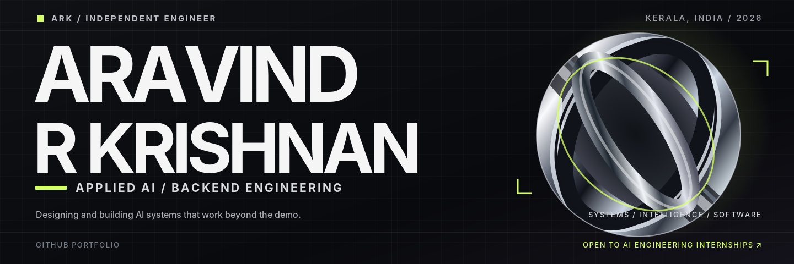

  

  <a href="https://www.linkedin.com/in/aravind-r-krishnan-7765232b4/">LinkedIn</a> &nbsp;·&nbsp;
  <a href="mailto:aravindrkrishnan339@gmail.com">Email</a> &nbsp;·&nbsp;
  <a href="https://github.com/AravindRKrishnan7?tab=repositories">Repositories</a>

## 01 / About

I'm a final-year Computer Science student from Kerala, India, focused on **Applied AI and backend engineering**.

I like building systems where language models interact with real data, APIs, and tools—not just chat interfaces. I'm especially interested in how these systems retrieve reliable information, perform actions, handle failures, and become useful software.

Currently strengthening my software-engineering foundations while building with **Python, FastAPI, databases, LLM APIs, and agent workflows**.

**Open to remote Applied AI / LLM / Python backend engineering internships.**

## 02 / Selected work

**[Anchor — Maritime Knowledge Assistant](https://github.com/AravindRKrishnan7/anchor-rag)** 
An Applied AI project for exploring maritime professionals, companies, and interview knowledge. Built around a FastAPI backend, PostgreSQL/Supabase, hybrid retrieval, and LLM integration to answer questions using structured information and document evidence.

`Python` · `FastAPI` · `PostgreSQL` · `Supabase` · `RAG` · `pgvector` · `LLM APIs`

## 03 / Technical focus

| Area | Technologies & concepts |
| :--- | :--- |
| **Backend** | Python, FastAPI, Pydantic, REST APIs, SQL, PostgreSQL |
| **Applied AI** | LLM APIs, RAG, embeddings, hybrid retrieval, tool calling, structured outputs |
| **Agent systems** | Agent workflows, MCP, tool integration, grounding and guardrails |
| **Development** | Git, GitHub, pytest, Docker, Postman, Render |

I'm particularly interested in **AI evaluation, reliability, security, and inference performance**—areas I'm continuing to explore through hands-on projects.

## 04 / Beyond code

- **HacKP 2026 — Finalist:** Top 50 out of 1,800+ entries at Kerala Police Cyberdome's hackathon.
- **IEEE Computer Society Kerala Section:** Technical Coordinator, Student Leadership Team 2026.
- **IEEE Computer Society, CCET:** Student Branch Chapter Chairperson.
- **CMR HackFest, Hyderabad:** Top 20 nationally.

## 05 / Currently exploring

- Building reliable tool-using AI applications and backend services.
- Improving RAG grounding, evaluation, and failure handling.
- Contributing to open-source software and developing stronger engineering fundamentals.

---

  <strong>Have an interesting AI engineering problem?</strong> 
  <a href="mailto:aravindrkrishnan339@gmail.com">Let's talk</a> &nbsp;·&nbsp;
  <a href="https://www.linkedin.com/in/aravind-r-krishnan-7765232b4/">Connect on LinkedIn</a>

